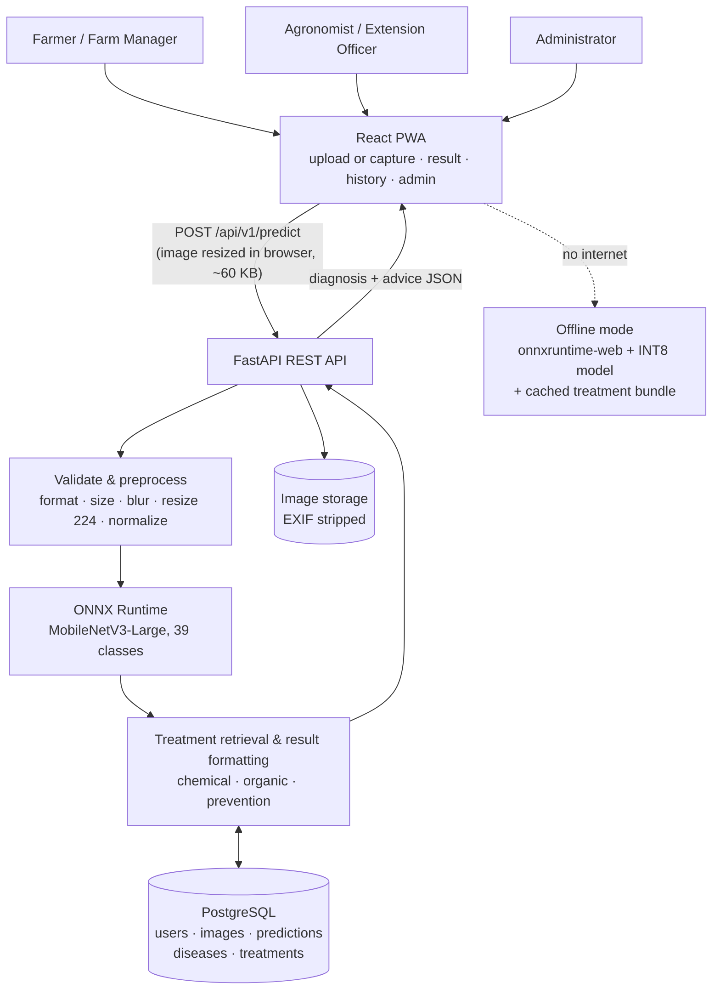
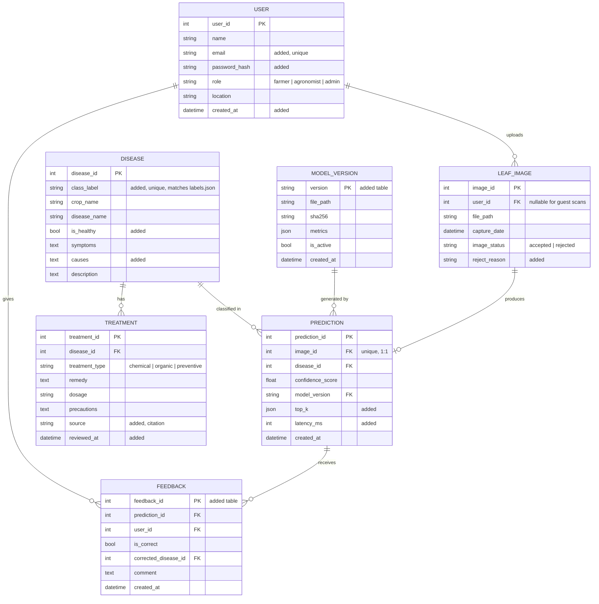

# Implementation Plan — Plant/Crop Disease Detector

**Image classification · CNN + REST API + React.js + Disease Treatment Database**

| | |
|---|---|
| Student | MD. Ridwan Islam Peyal (0242310005341081) |
| Supervisor | Uttam Kumar Dey, Assistant Professor, Dept. of Software Engineering, DIU |
| Source | Mid-defence presentation (`Peyal _mid defence_1081.pptx.pdf`) |
| Methodology | Agile Scrum: six 2-week sprints, Kanban board, code review on every merge |
| Plan version | 0.1, 2026-11-20 |

---

## 1. What we are building

A web app where a farmer or agronomist uploads or photographs a crop leaf. Within 2 seconds it returns:

1. the predicted disease (or "healthy"),
2. a confidence score, and
3. practical treatment advice: chemical dosage, organic remedy and prevention.

Each scan is saved to a history log. An administrator manages the disease and treatment records, deploys new model versions and reviews logs and user feedback. A lightweight copy of the model also runs in the browser, so diagnosis still works with no internet connection.

### Objectives → how this plan meets them

| # | Objective (from slide 3) | Delivered by |
|---|---|---|
| O1 | High-accuracy CNN with transfer learning (MobileNetV3 / ResNet50) | §5 ML pipeline: train both, deploy MobileNetV3-Large |
| O2 | Classify 38+ disease categories | PlantVillage 38 classes plus 1 "not a leaf" class = 39 |
| O3 | Responsive React.js UI for upload/capture and results | §8 Frontend |
| O4 | Python REST API for preprocessing, inference and treatment retrieval | §7 Backend (FastAPI) |
| O5 | Chemical dosage, organic remedy, prevention, with a confidence score | §6 Treatment knowledge base + Result page |
| O6 | Prediction latency under 2 s, usable with low bandwidth and at the edge | Client-side image resize, ONNX Runtime, quantized offline model (§9) |

---

## 2. Technology decisions

| Layer | Choice | Why |
|---|---|---|
| Model training | **PyTorch** + torchvision on Google Colab / Kaggle (free GPU) | ImageNet-pretrained MobileNetV3-Large and ResNet50 are built in; no local GPU needed |
| Model format | **ONNX**: FP32 for the server, INT8-quantized for the browser | One exported model serves both the API and offline mode |
| Server inference | **ONNX Runtime** (CPU) | MobileNetV3 runs in tens of milliseconds on a CPU; no GPU server needed |
| Offline inference | **onnxruntime-web** (WebAssembly) | Runs the same `.onnx` file inside the browser |
| Backend | **Python 3.11, FastAPI**, Uvicorn, Pydantic v2, SQLAlchemy 2, Alembic | Async, automatic Swagger docs at `/docs` (useful for the report and viva), typed request/response schemas |
| Database | **PostgreSQL** in deployment, **SQLite** for local development | Same SQLAlchemy models work on both |
| Image handling | Pillow (decode, EXIF, resize) + OpenCV (blur check) | Matches the feasibility study on slide 7 |
| Auth | JWT bearer tokens, bcrypt password hashes; roles `farmer`, `agronomist`, `admin` | Matches the two actors in the use-case diagram |
| Frontend | **React + Vite + TypeScript**, Tailwind CSS, React Router, TanStack Query | Fast builds, typed API client, mobile-first styling |
| Offline / PWA | vite-plugin-pwa (Workbox service worker) + IndexedDB (Dexie) | Installable app, cached model, offline history |
| Testing | pytest + httpx · Vitest + React Testing Library + MSW · Playwright · Locust | Unit, API, UI, end-to-end and latency tests |
| DevOps | Docker + docker-compose, GitHub Actions CI | Same setup locally and in deployment |

> **About PyTorch vs TensorFlow:** the slides allow either. With PyTorch + ONNX, a single model file runs on both the server and in the browser. If your supervisor prefers TensorFlow, swap in Keras → TFLite / TF.js. Only the `ml/` folder and the offline module change; the API, database and UI stay the same.

---

## 3. System architecture

This follows the "Proposed System Architecture" on slide 12.



**Contract that holds the system together:** at training time, `labels.json` (class index → class label such as `Tomato___Early_blight`) is created and shipped with every model version. Each label must match exactly one `diseases.class_label` row in the database. An automated test enforces this (§10).

---

## 4. Repository layout

```
Crop disease detector/
├── ml/                          # training & evaluation (runs on Colab/Kaggle)
│   ├── configs/                 # one YAML per experiment (model, lr, epochs, augmentations)
│   ├── src/
│   │   ├── data.py              # download, dedupe, stratified split, transforms
│   │   ├── models.py            # MobileNetV3-Large / ResNet50 builders
│   │   ├── train.py             # two-stage fine-tuning, checkpoints, early stopping
│   │   ├── evaluate.py          # metrics, confusion matrix, per-class report, Grad-CAM
│   │   └── export_onnx.py       # ONNX export, parity check, INT8 quantization
│   ├── notebooks/               # Colab notebook that calls src/ (EDA, training runs)
│   └── reports/                 # metrics JSON + plots (tracked in git; weights are not)
├── backend/
│   ├── app/
│   │   ├── main.py              # FastAPI app, startup loads active model
│   │   ├── core/                # settings (.env), security/JWT, logging
│   │   ├── api/v1/              # routers: auth, predict, history, diseases, offline, admin
│   │   ├── models/              # SQLAlchemy ORM tables
│   │   ├── schemas/             # Pydantic request/response models
│   │   ├── services/            # preprocessing, inference, treatment lookup, storage
│   │   └── db/                  # session, base
│   ├── alembic/                 # migrations
│   ├── seed/                    # diseases.json, treatments.json, seed.py
│   ├── model_store/             # active .onnx + labels.json (gitignored)
│   └── tests/
├── frontend/
│   ├── src/
│   │   ├── pages/               # Diagnose, Result, History, Library, Login, Admin/*
│   │   ├── components/          # Uploader, CameraCapture, ConfidenceBar, TreatmentTabs…
│   │   ├── features/offline/    # preprocess.ts, onnx runner, IndexedDB store
│   │   ├── api/                 # typed client + TanStack Query hooks
│   │   └── i18n/                # en (Bangla optional, see §14)
│   └── tests/
├── e2e/                         # Playwright scenarios
├── docs/                        # wireframes, UML/ERD, user manual, deployment guide, model card
├── docker-compose.yml
├── .github/workflows/ci.yml
└── IMPLEMENTATION_PLAN.md
```

Model weights (`.pt`, `.onnx`) are never committed. Store them with Git LFS or as GitHub Release assets, and record each version's SHA-256 in the database.

---

## 5. ML pipeline (Activity Diagram, part A)

### 5.1 Dataset

| Item | Plan |
|---|---|
| Primary dataset | **PlantVillage, original colour version** (~54k images, 38 classes, 14 crops; Hughes & Salathé 2015). Available from TensorFlow Datasets (`plant_village`) or the Kaggle mirror of the original `color/` folder. |
| Avoid | The pre-augmented "New Plant Diseases Dataset" variant. Its train and validation folders contain augmented copies of the same leaves, so validation accuracy comes out falsely high. |
| Extra class | `Background___not_a_leaf`: about 1,500 non-leaf images (soil, hands, sky, random objects). Without it, the model forces every photo into one of the 38 classes. |
| Field test set | **PlantDoc** images for the overlapping classes. Used only for testing, to measure real-field accuracy honestly. |
| Coverage | 14 crops: Apple, Blueberry, Cherry, Corn, Grape, Orange, Peach, Bell Pepper, Potato, Raspberry, Soybean, Squash, Strawberry, Tomato. That is 26 disease classes plus 12 healthy classes. |

**Cleaning steps:** remove exact and near-duplicate images (perceptual hash), drop corrupt files, check that labels match folder names, and record the per-class counts. The classes are imbalanced, from about 150 to about 5,500 images each.

**Split:** stratified 70 / 15 / 15 (train / validation / test), done **before** any augmentation, with a fixed random seed. Save the split as CSV files in `ml/reports/` so every experiment uses the same split.

### 5.2 Preprocessing spec (single source of truth)

Server, training evaluation and the browser must all apply exactly these steps:

1. Fix orientation from EXIF, convert to RGB.
2. Resize so the shorter side is 256 px (bilinear).
3. Centre-crop to 224 × 224.
4. Scale pixels to [0, 1], normalize with ImageNet mean `[0.485, 0.456, 0.406]` and std `[0.229, 0.224, 0.225]`.
5. Arrange as NCHW float32, shape `[1, 3, 224, 224]`.

### 5.3 Training augmentations (training set only)

RandomResizedCrop(224, scale 0.6–1.0) · horizontal and vertical flips · rotation ±25° · ColorJitter (brightness, contrast, saturation 0.3, hue 0.05) · Gaussian blur (p = 0.2) · RandomErasing (p = 0.2).

PlantVillage photos have plain lab backgrounds. These augmentations help the model cope with real phone photos.

### 5.4 Models and training recipe

| | MobileNetV3-Large (**deploy**) | ResNet50 (baseline for comparison) |
|---|---|---|
| Parameters / FP32 size | ~5.4 M / ~21 MB | ~25.6 M / ~98 MB |
| Why | Fast on CPU and in the browser; meets O6 | Stronger reference point for the report |

Both models use the same recipe:

- **Stage 1 (head only):** freeze the backbone, replace the classifier with 39 outputs, AdamW lr 1e-3, 3–5 epochs.
- **Stage 2 (full fine-tune):** unfreeze everything, AdamW lr 1e-4 with cosine decay, up to 25 epochs, early stopping on validation macro-F1 (patience 5).
- Label smoothing 0.1, class-weighted loss for the imbalance, mixed precision, batch size 64.
- Save checkpoints to Google Drive so a dropped Colab session doesn't lose work.

### 5.5 Evaluation (bottom box of Activity Diagram A)

On the held-out test split, report:

- accuracy and top-3 accuracy
- macro precision, recall and F1
- a per-class classification report
- a confusion matrix (plot)
- CPU latency and model size

Report the same metrics on the PlantDoc field set.

**Grad-CAM heatmaps** on sample images show which part of the leaf the model looked at. They make strong figures for the final report.

**Targets:** PlantVillage test accuracy ≥ 97% and macro-F1 ≥ 0.95. Report field-set accuracy separately and honestly: Mohanty et al. (2016), already in your references, saw accuracy fall to about 31% on images from outside the lab dataset.

**Confidence threshold:** choose τ on the validation set (starting point: 0.60). Predictions below τ, or predicted as `not_a_leaf`, are reported as "uncertain — please retake the photo" instead of a diagnosis.

### 5.6 Export and optimization

1. Export to ONNX (opset 17) using `torch.onnx.export`.
2. **Parity check:** PyTorch and ONNX Runtime outputs must differ by less than 1e-4 and give identical top-1 predictions on the whole test set.
3. Quantize to INT8 for the browser (about 5–6 MB). Accept it only if test accuracy drops by less than 1 point.
4. Publish `model.onnx`, `model.int8.onnx`, `labels.json` and `metrics.json` as one versioned bundle, e.g. `mnv3l-v1.0`.

---

## 6. Database & treatment knowledge base

### 6.1 Schema

This follows the slide 12 ERD. Fields marked ➕ are additions, needed for login, the admin use cases (model deploy, logs and feedback) and treatment sources.



### 6.2 Treatment content

- **Volume:** 39 disease rows, one per model class. Each of the 26 disease classes gets at least 1 chemical, 1 organic and 1 preventive treatment. The 12 healthy classes get preventive and good-practice care tips. `not_a_leaf` has no treatments.
- **Sources** (store the citation in `treatment.source`): Bangladesh Agricultural Research Institute (BARI), Department of Agricultural Extension (DAE), FAO, and university extension and integrated pest management (IPM) guides. Every dosage must come from a pesticide label or an official guide. **Never invent dosages.**
- **Review:** ask an agronomy officer from your elicitation interviews, or your supervisor's contact, to review the chemical entries. Record the date in `reviewed_at`.
- **Storage:** `backend/seed/diseases.json` and `treatments.json` are versioned in git and loaded by `seed.py`. The data can be edited later from the admin panel.
- **Safety in the UI:** every result shows a disclaimer: *"Advisory only. Follow the product label and local regulations; consult your Upazila Agriculture Officer for confirmation."* When confidence is low, chemical dosages are hidden.

---

## 7. Backend API (FastAPI)

### 7.1 Endpoints (all under `/api/v1`)

| Method | Path | Auth | Purpose | Covers |
|---|---|---|---|---|
| GET | `/health` | – | Liveness + active model version | Ops |
| POST | `/auth/register`, `/auth/login` | – | Create account / get JWT | – |
| GET | `/auth/me` | user | Current profile | – |
| POST | `/predict` | optional | Upload image → diagnosis, confidence, treatments | FR-01–04 |
| GET | `/history` | user | Paginated past scans (newest first) | FR-05 |
| GET | `/history/{prediction_id}` | owner | Scan detail with image and advice | FR-05 |
| GET | `/images/{image_id}` | owner / admin | Serve the stored image | FR-05 |
| POST | `/predictions/{id}/feedback` | user | "Was this correct?" + comment | Admin review |
| GET | `/diseases?crop=` · `/diseases/{id}` | – | Disease library with treatments | FR-04 |
| GET | `/offline/bundle` | – | labels + diseases + treatments JSON for offline mode | Offline |
| GET | `/model/latest` | – | Version, SHA-256, size and URL of the browser model | Offline |
| CRUD | `/admin/diseases`, `/admin/treatments` | admin | Manage records | Admin UC |
| POST | `/admin/models` · `/admin/models/{v}/activate` | admin | Upload a model bundle, switch the active version | Admin UC |
| GET | `/admin/logs` | admin | Predictions, rejected uploads, feedback, basic stats | Admin UC |

### 7.2 `/predict` flow (FR-01 → FR-04)

1. **Receive** multipart `file` (JPEG/PNG). Limit: 10 MB.
2. **Validate (FR-02).** Every rejection returns HTTP 422 with a `reason` code:
   - real image check (Pillow decode, not just the file extension) → `UNSUPPORTED_FORMAT`
   - size → `FILE_TOO_LARGE`
   - minimum 128 × 128 px → `TOO_SMALL`
   - variance of the Laplacian below a threshold → `TOO_BLURRY`
   - mean brightness out of range → `TOO_DARK` / `TOO_BRIGHT`
3. **Store** the image with EXIF removed (this also strips GPS location data) at `uploads/{yyyy}/{mm}/{uuid}.jpg`.
4. **Preprocess** using the §5.2 spec, then **infer** with ONNX Runtime. The model is loaded once at startup, not per request.
5. **Decide:** if the top class is `not_a_leaf` → status `not_a_leaf`; if the top-1 score is below τ → status `low_confidence`; otherwise → `ok`.
6. **Look up** the disease and its treatments by `class_label`. Save `leaf_image` and `prediction` rows.
7. **Return:**

```jsonc
{
  "prediction_id": 1287,
  "status": "ok",                     // ok | low_confidence | not_a_leaf
  "model_version": "mnv3l-v1.0",
  "class_label": "Tomato___Early_blight",
  "crop": "Tomato",
  "disease": "Early blight",
  "is_healthy": false,
  "confidence": 0.94,
  "confidence_band": "high",          // high ≥ 0.85 · medium ≥ τ · low < τ
  "top_k": [
    { "class_label": "Tomato___Early_blight", "confidence": 0.94 },
    { "class_label": "Tomato___Septoria_leaf_spot", "confidence": 0.03 },
    { "class_label": "Tomato___Target_Spot", "confidence": 0.01 }
  ],
  "disease_info": { "symptoms": "…", "causes": "…", "description": "…" },
  "treatments": {
    "chemical":   [{ "remedy": "…", "dosage": "…", "precautions": "…", "source": "…" }],
    "organic":    [{ "remedy": "…", "dosage": "…", "precautions": "…", "source": "…" }],
    "preventive": [{ "remedy": "…", "precautions": "…", "source": "…" }]
  },
  "timing_ms": { "preprocess": 18, "inference": 35, "total": 92 }
}
```

### 7.3 Security & reliability

- Hash passwords with bcrypt. JWTs expire after 60 min. Admin routes check the user's role.
- Restrict CORS to the frontend origin. Rate-limit `/predict` (e.g. 30 requests/min per IP with `slowapi`).
- Keep secrets in `.env` (never committed). The first admin account is created from environment variables by `seed.py`.
- Log in structured JSON with a request ID, and record per-request timings for the latency report.
- **Model activation** loads the new ONNX session and swaps it in atomically, so requests already in progress finish on the old model.

---

## 8. Frontend (React + Vite + TypeScript)

| Page | Contents | FR / Use case |
|---|---|---|
| **Diagnose** (home) | Drag-and-drop / file picker, **Take photo** button, preview, crop-to-leaf hint, list of supported crops, Analyze button | FR-01 |
| **Result** | Crop + disease name, confidence bar with High/Medium/Low label, top-3 alternatives, tabs **Chemical · Organic · Prevention**, symptoms & causes, disclaimer, "Was this correct?" buttons | FR-03, FR-04 |
| **History** | Cards with thumbnail, disease, confidence and date; filter by crop; opens Result view | FR-05 |
| **Disease Library** | Browse diseases by crop (reuses treatment data) | FR-04 |
| **Login / Register** | Email + password; role chosen at signup (farmer / agronomist) | – |
| **Admin** | Disease & treatment CRUD · model versions (upload, metrics, activate) · logs & feedback review · simple stats (scans per day, top diseases, % low-confidence) | Admin UCs |
| **Settings** | "Download for offline use", model version, clear local data | Offline UC |

**Key implementation details**

- **Camera capture:**
  - `<input type="file" accept="image/*" capture="environment">` opens the rear camera on phones and works everywhere.
  - On desktop, add a `getUserMedia` webcam view.
  - Both need HTTPS; `localhost` is fine for development.
- **Low-bandwidth upload:** before upload, resize in the browser to at most 512 px on the long side and compress to JPEG quality 0.85 (about 40–80 KB instead of 3–5 MB). This saves more time than any server optimization.
- **UX for farmers:**
  - large touch targets, icons next to labels, and plain-language wording ("Likely disease", not "class")
  - a progress state while analyzing
  - clear retry messages for each `reason` code
- **Responsive:** mobile-first layout that also works on desktop. Check at 360 px width.
- **Accessibility:** alt text, colour + text for confidence (never colour alone), keyboard navigation.

---

## 9. Offline / edge mode

Covers the "Use Offline / Edge Mode" use case and the "Optimized Model / Local Cache" box on slide 12.

1. **Install as PWA:** the service worker caches the app shell, so the app opens with no network.
2. **"Download for offline use"** fetches `model.int8.onnx` (about 5–6 MB) and `/offline/bundle` (labels + diseases + treatments). The files are stored in Cache Storage / IndexedDB, and the download is checked against the SHA-256 from `/model/latest`.
3. **Automatic fallback:** if the device is offline or `/predict` fails with a network error, the app runs the model in the browser with onnxruntime-web. `preprocess.ts` implements the §5.2 spec, and the result page is filled from the cached bundle. The result is marked "Diagnosed offline".
4. **Offline history:** offline scans are saved in IndexedDB with `synced: false`.
   - *Should-have:* when back online, upload them to the server history.
5. **Updates:** on startup, if online, compare the local model version with `/model/latest` and offer an update.
6. **Parity test:** five fixed sample images must give the same top-1 class and confidences within ±0.01 in Python and in the browser.

---

## 10. Testing strategy

| Level | Tool | What is tested |
|---|---|---|
| ML | pytest + scripts | ONNX parity; INT8 accuracy drop < 1 pt; **label contract**: every `labels.json` entry has a `diseases` row and every disease class has ≥ 1 treatment of each required type |
| Backend unit | pytest | Each validation rule (one fixture per reason code), preprocessing output shape and values, confidence banding, treatment lookup, JWT/roles |
| Backend API | pytest + httpx, SQLite test DB | `/predict` happy path + every 422; history only shows the owner's scans; admin routes reject non-admins |
| Frontend | Vitest + React Testing Library + MSW | Uploader rejects wrong types, Result renders all three statuses, treatment tabs, history list |
| End-to-end | Playwright (desktop + mobile viewport) | Upload sample leaf → result → appears in history; admin edits a treatment → change visible in result; offline: go offline → diagnose still works |
| Performance | Locust + Chrome DevTools throttling | p95 server time < 300 ms with 20 concurrent users; end-to-end < 2 s on slow-4G/3G throttling (O6) |
| Usability | Task-based sessions with 5–8 farmers / extension officers + SUS questionnaire | Can they diagnose without help? SUS ≥ 70. Feeds back from the elicitation plan (slide 9). |

**CI (GitHub Actions)** runs on every push: ruff + eslint, `tsc --noEmit`, pytest, Vitest, then a Docker build. Target backend test coverage: ≥ 80%.

---

## 11. Sprint plan (aligned with the Gantt chart on slide 10)

> Scope, ERD, use-case and activity diagrams from Phase 1 were already presented at mid-defence. "Week 1" below means the first week of implementation.
> **Key rule:** get a rough end-to-end version working by the end of Week 4 (upload → API → model → result on screen), even if it's ugly. That way integration problems appear early, not in Week 8.

### Sprint 1 — Weeks 1–2 · Requirements, setup, data (Phase 1)
- [ ] Turn elicitation results into user stories with acceptance criteria. Put them on a Kanban board (GitHub Projects or Trello).
- [ ] `git init`, create the §4 folder structure, `.gitignore`, `.env.example`, CI skeleton.
- [ ] Download PlantVillage (original colour) + PlantDoc. Run EDA notebook: class counts, sample grid, image sizes.
- [ ] Remove duplicates and corrupt files, build the `not_a_leaf` set, create and save the stratified split CSVs.
- [ ] Wireframes (Figma or paper): Diagnose, Result, History, Admin, on mobile and desktop.

**Done when:** CI passes on an empty project, the split CSVs are committed, and the wireframes have been reviewed with your supervisor.

### Sprint 2 — Weeks 3–4 · Transfer-learning setup + rough end-to-end version (Phase 1 → 2)
- [ ] `ml/src/data.py` with transforms, `models.py`, and `train.py` with config files.
- [ ] Quick baseline: MobileNetV3, Stage 1 only (head only), then export to ONNX.
- [ ] Backend: FastAPI skeleton, settings, SQLAlchemy models for the §6.1 schema, first Alembic migration, `/health`, `/predict` (validation + inference, placeholder treatments).
- [ ] Frontend: Vite + React + Tailwind project, Diagnose page that posts to `/predict` and prints the result.
- [ ] Start the treatment data spreadsheet: list all 39 classes and their sources.

**Done when:** a leaf photo uploaded in the browser shows a predicted disease and confidence, running locally.

### Sprint 3 — Weeks 5–6 · Model training, API, treatment DB, UI (Phase 2)
- [ ] Full two-stage training of MobileNetV3-Large and ResNet50. Log every run (config + metrics) to `ml/reports/`.
- [ ] `evaluate.py`: confusion matrix, per-class report, PlantDoc field evaluation, Grad-CAM figures.
- [ ] Treatment content for all classes in `seed/*.json`, loaded with `seed.py`. Send the chemical entries for agronomist review.
- [ ] Auth (register / login / me), `/history`, `/diseases`, image storage with EXIF removed.
- [ ] Frontend: Result page with treatment tabs, camera capture, browser resize/compression, History page, Login.

**Done when:** FR-01 to FR-05 work end-to-end on the dev setup, with real treatment data for at least the tomato and potato classes.

### Sprint 4 — Weeks 7–8 · Finish implementation + system integration (Phase 2 → 3)
- [ ] Pick the deploy model (accuracy vs latency table). Tune τ on the validation set. Run the parity check. Create the INT8 model. Publish the `mnv3l-v1.0` bundle.
- [ ] Admin backend + UI: disease & treatment CRUD, model upload/activate, logs & feedback, stats.
- [ ] Feedback endpoint + "Was this correct?" UI, Disease Library page.
- [ ] **Week 8 integration:** docker-compose (db + api + web) runs the whole system. Complete all treatment content. Polish error and edge states.

**Done when:** `docker compose up` runs the full system, every use case on slide 13 can be demonstrated, and treatment data covers all 39 classes.

### Sprint 5 — Weeks 9–10 · Testing, optimization, offline mode (Phase 3)
- [ ] Write the §10 unit, API, frontend and E2E tests. Reach ≥ 80% backend coverage.
- [ ] Offline mode: PWA, model download, onnxruntime-web runner, `preprocess.ts` + parity test, offline history.
- [ ] Latency work: profile with Locust + DevTools throttling, fix slow spots, record the numbers for the report.
- [ ] Usability sessions with farmers / extension officers (SUS). Fix the top issues.
- [ ] Bug fixing from the Kanban board.

**Done when:** all tests pass in CI, p95 end-to-end time is under 2 s, and an offline diagnosis works in airplane mode on a real phone.

### Sprint 6 — Weeks 11–12 · Deployment & documentation (Phase 4)
- [ ] Deploy to a small VPS (2 vCPU / 4 GB) or Render/Railway, with **HTTPS** (needed for the camera and the service worker) and a production `.env`.
- [ ] Edge checks on real low-end Android phones: install the PWA, offline flow, memory use.
- [ ] **Code freeze at the end of Week 11.**
- [ ] Documents:
  - final report: methodology, dataset, MobileNetV3 vs ResNet50 comparison, confusion matrix, Grad-CAM, field accuracy, latency, test results, limitations
  - user manual (with screenshots)
  - deployment guide
  - model card: data, metrics, limitations, intended use
- [ ] Presentation slides + a 3-minute backup demo video (in case the live demo fails).

**Done when:** a public HTTPS demo URL works, all deliverables from slide 6 are submitted, and the defence rehearsal is done.

---

## 12. Requirements traceability

| Requirement | Implemented in | Verified by |
|---|---|---|
| FR-01 Image upload & capture | `Uploader`, `CameraCapture`, `POST /predict` | RTL tests, Playwright upload + mobile capture |
| FR-02 Preprocessing & validation | `services/preprocessing.py`, `preprocess.ts` | Unit tests per reason code, parity test |
| FR-03 Classification & scoring | `services/inference.py`, ONNX model | Test-set metrics, API tests, confidence-band tests |
| FR-04 Treatment display | `treatments` table, `TreatmentTabs`, `/diseases` | Label-contract test, E2E result check |
| FR-05 Diagnostic history log | `predictions` table, `/history`, History page | API ownership tests, E2E "appears in history" |
| UC Offline / edge mode | PWA + onnxruntime-web + bundle | E2E offline test, real-device check |
| UC Admin: model, records, logs | `/admin/*`, Admin pages | Role tests, E2E admin edit |
| O6 latency < 2 s | Browser resize, ONNX Runtime, INT8 | Locust p95, DevTools throttled runs |

---

## 13. Risks and mitigations

| Risk | Impact | Mitigation |
|---|---|---|
| Lab-to-field gap: PlantVillage has plain backgrounds, real photos don't | High | Strong augmentation, `not_a_leaf` class, confidence threshold with retake advice, PlantDoc evaluation, honest reporting |
| Wrong or unsafe chemical advice | High | Cited sources only, agronomist review, disclaimer, dosage hidden when confidence is low |
| Data leakage gives inflated accuracy | Medium | Original dataset, dedupe, split before augmentation, fixed split files |
| Limited GPU time on Colab | Medium | MobileNetV3 is light; mixed precision; checkpoints saved to Drive; Kaggle as backup |
| Browser vs server preprocessing mismatch | Medium | One written spec (§5.2) + automated parity test |
| Camera / PWA blocked without HTTPS | Medium | `localhost` in dev, HTTPS in deployment, file-input fallback |
| Schedule slip | Medium | Rough end-to-end version by Week 4; priority list below; background sync is the first thing cut |
| Main Bangladeshi crops (rice, jute, wheat) not in PlantVillage | Scope | State this in the report as a limitation and future work. The design lets you add classes by retraining and adding seed rows, with no code changes. |

### Priority (MoSCoW)

- **Must:** FR-01 to FR-05, 39-class model ≥ 97% test accuracy, treatment data for every class, admin treatment CRUD, latency < 2 s, deployment over HTTPS.
- **Should:** offline diagnosis (PWA + browser model), admin model upload/activate, feedback & logs view, PlantDoc field evaluation, Disease Library.
- **Could:** Grad-CAM heatmap shown in the UI, offline history sync, Bangla interface, admin stats charts.
- **Won't (out of scope, slide 5):** drone/UAV scanning, multi-spectral video, robotic spraying, IoT sensors, farm machinery control.

---

## 14. Decisions to confirm with your supervisor

1. **PyTorch + ONNX** (this plan) or **TensorFlow + TFLite/TF.js**? Only the `ml/` folder changes.
2. **Guest diagnosis:** can someone diagnose without logging in? This plan says yes; history is saved on the server only for logged-in users, and guests keep history in the browser.
3. **Bangla UI:** add it for the core flow? It costs about 2 days with `react-i18next`, and the target users would benefit a lot.
4. **Hosting:** university server, VPS or a free platform (Render/Railway)?

---

## 15. Immediate next steps (this week)

1. Confirm the four decisions in §14.
2. Run `git init`, create the §4 folders, and push to GitHub with a basic CI workflow.
3. Set up tools: Python 3.11 virtual environment for `backend/`, `npm create vite@latest frontend -- --template react-ts`, and a Colab notebook for `ml/`.
4. Download PlantVillage (original colour) and run the EDA + dedupe + split notebook.
5. Create the Kanban board from the Sprint 1 checklist above.

---

### References

- Hughes, D., & Salathé, M. (2015). *An open access repository of images on plant health to enable the development of mobile disease diagnostics.* arXiv:1511.08060.
- Mohanty, S. P., Hughes, D. P., & Salathé, M. (2016). *Using deep learning for image-based plant disease detection.* Frontiers in Plant Science, 7, 1419.
- Howard, A., et al. (2019). *Searching for MobileNetV3.* ICCV.
- Singh, D., et al. (2020). *PlantDoc: A dataset for visual plant disease detection.* CoDS-COMAD.
- FAO (2021). *New standards to prevent international spread of plant pests and diseases.* Rome: FAO.
