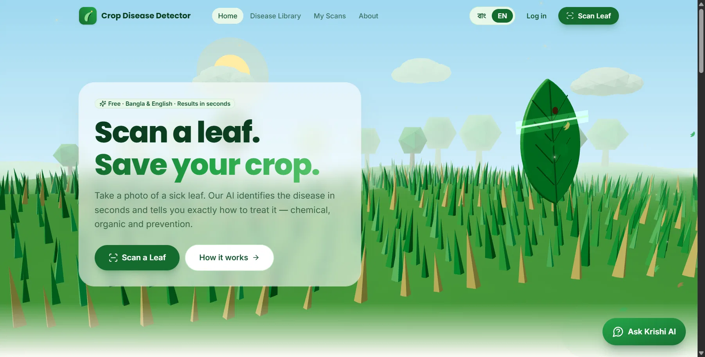
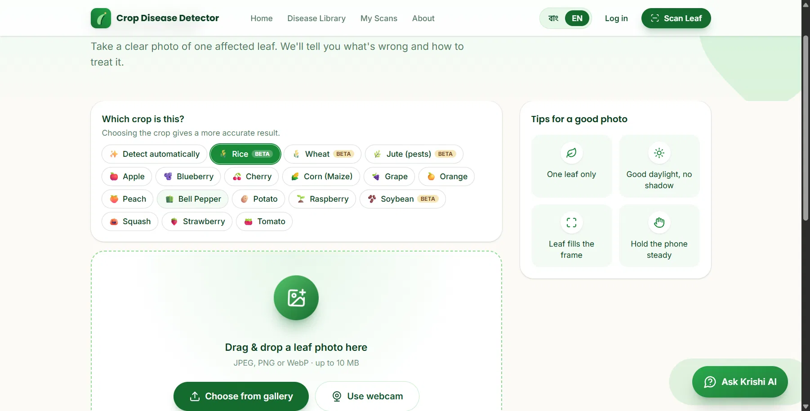
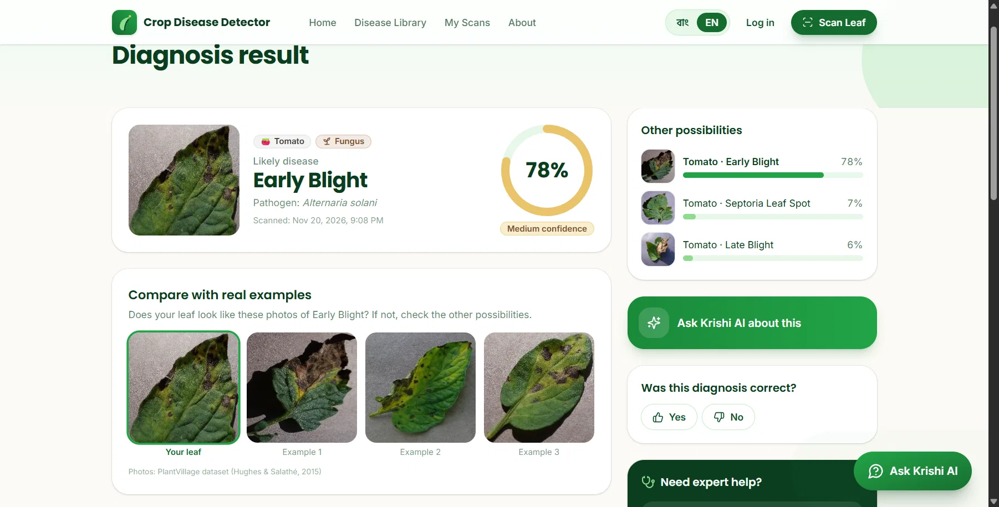
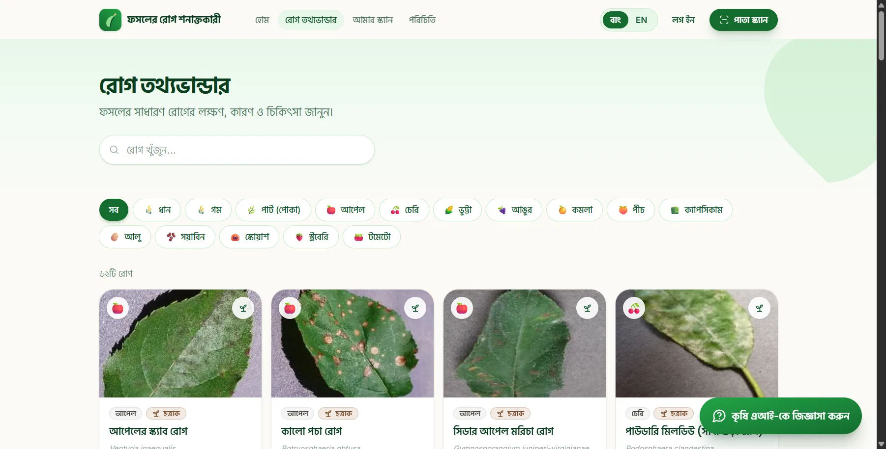
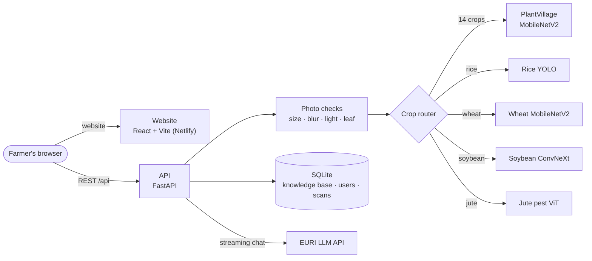

<div align="center">


# Crop Disease Detector

**Snap a leaf. Know the disease. Get the treatment — in Bangla and English.**

AI-powered crop health assistant for farmers in Bangladesh and beyond. One photo returns the likely disease or pest,
a confidence score, real reference photos and a clear chemical, organic and preventive treatment plan.


[Features](#features) · [Supported crops](#supported-crops) · [Architecture](#architecture) · [Quick start](#quick-start) · [Deployment](#deployment) · [API](#api)

<br />



</div>

---

## Features

| | |
|---|---|
| 🔍 **Instant diagnosis** | Upload or capture a leaf photo and get the top-3 likely diseases with confidence scores in about two seconds. |
| 🌾 **17 crops, 77 classes** | Diseases, insect pests and healthy states — including rice, wheat and jute for Bangladesh. |
| 🎯 **Crop-aware AI** | Choosing a crop routes the photo to a model trained for that crop and restricts answers to its classes. |
| 💊 **Actionable treatment** | Chemical products with dosage and safety precautions, organic alternatives and prevention tips. |
| 🛡️ **Honest confidence** | Low-confidence results hide chemical doses and show other possibilities instead of guessing. |
| 🖼️ **Compare with real photos** | Every result shows reference photos of the predicted disease next to the farmer's leaf. |
| 🤖 **Krishi AI assistant** | Streaming chat for follow-up questions, aware of the current diagnosis, in the user's language. |
| 🇧🇩 **Bangla first** | Every screen, disease page and treatment is fully bilingual (বাংলা / English). |
| 📚 **Disease library** | Searchable library of symptoms, causes and treatments, filterable by crop. |
| 👤 **Accounts & history** | Optional sign-up to keep scan history; guests can scan without an account. |
| 📊 **Admin dashboard** | Usage statistics, recent scans, user feedback and an editor for the disease knowledge base. |
| 📱 **Works on any phone** | Responsive website with a 3D landing page and a lite mode for slow devices and connections. |

## Screenshots

<table>
  <tr>
    <td width="50%"><p align="center"><sub>Scan — choose a crop and upload a leaf</sub></p></td>
    <td width="50%"><p align="center"><sub>Result — diagnosis, confidence and real examples</sub></p></td>
  </tr>
  <tr>
    <td width="50%"><p align="center"><sub>Disease library — fully in Bangla</sub></p></td>
    <td width="50%"><p align="center"><sub>Home — interactive 3D field</sub></p></td>
  </tr>
</table>

## Supported crops

| Crop | Classes | Model | Status |
|---|---:|---|---|
| Apple, Blueberry, Cherry, Corn (Maize), Grape, Orange, Peach, Bell Pepper, Potato, Raspberry, Squash, Strawberry, Tomato (+ healthy Soybean) | 38 | MobileNetV2 · PlantVillage | ✅ Available |
| 🌾 Rice — Bacterial Leaf Blight, Brown Spot, Leaf Blast, Leaf Scald, Narrow Brown Leaf Spot, Sheath Blight, Hispa, Healthy | 8 | YOLO classifier | 🧪 Beta |
| 🌾 Wheat — Black, Brown and Yellow Rust, Leaf Blight, Flag Smut, Scab, Powdery Mildew, Healthy | 8 | MobileNetV2 | 🧪 Beta |
| 🫘 Soybean — Downy Mildew, Frogeye Leaf Spot, Mosaic Virus, Rust, Septoria Brown Spot, Healthy | 6 | ConvNeXt | 🧪 Beta |
| 🌿 Jute — 17 insect pests (Yellow Mite, Semilooper, Hairy Caterpillar, Stem Weevil, …) | 17 | Vision Transformer | 🧪 Beta |

### Model quality

- **Main model (14 crops):** ~95% accuracy on the PlantVillage benchmark. Field photos (poor light, several leaves,
  cluttered background) score lower.
- **Beta models:** in internal tests on 64 labelled Bangladeshi rice photos about half were classified correctly
  (Brown Spot and healthy leaves reliably; Blast and Bacterial Leaf Blight often missed). Soybean reached ~50% on an
  independent photo set. Wheat and jute have not yet been tested on local field photos.
- Results below the confidence threshold (60%) are shown as uncertain, and chemical doses are hidden.

> [!IMPORTANT]
> Results are decision support, not a final diagnosis. Always follow the product label and local regulations, and
> confirm with an agriculture officer (Bangladesh: Krishi Call Center **16123**) before applying chemicals.

## Architecture



**How a diagnosis works**

1. The photo is validated (format, size, blur, brightness) and checked for plant content.
2. The selected crop's ONNX model scores the photo; predictions are restricted to that crop's classes.
3. The top-3 classes are mapped to the bilingual knowledge base (symptoms, causes, treatments).
4. The uploaded photo is re-encoded without EXIF metadata (no GPS location) and stored with the scan.

## Tech stack

| Layer | Technology |
|---|---|
| Frontend | React 19, TypeScript, Vite 6, Tailwind CSS 4, React Router 7, Motion, i18next, Three.js (React Three Fiber) |
| Backend | Python, FastAPI, SQLAlchemy 2, SQLite, Pydantic Settings, PyJWT + bcrypt |
| AI / ML | ONNX Runtime (CPU) — five pre-trained image models exported from PyTorch, Transformers, timm and Ultralytics |
| Chat | EURI (OpenAI-compatible) streaming API, proxied by the backend so the key never reaches the browser |
| Testing | Vitest + Testing Library (frontend), pytest with the real models (backend) |

## Quick start

**Requirements:** Python 3.11+ and Node.js 20+.

### Windows (one command)

```powershell
.\start.ps1          # first run installs everything, then open http://localhost:8000
.\start.ps1 -Dev     # development: API on :8000 + live-reloading website on :5173
```

### macOS / Linux

```bash
# API
cd backend
python -m venv .venv && source .venv/bin/activate
pip install -r requirements.txt
cp .env.example .env                      # then edit the values
uvicorn app.main:app --reload --port 8000

# Website (second terminal)
cd frontend
npm install
echo "VITE_USE_MOCKS=false" > .env.local
npm run dev                               # http://localhost:5173 (proxies /api to :8000)
```

On first start the API creates the database, loads the disease knowledge base and creates the admin account from
`ADMIN_EMAIL` / `ADMIN_PASSWORD`.

## Configuration

**Backend** — `backend/.env` (see [`backend/.env.example`](backend/.env.example))

| Variable | Description | Default |
|---|---|---|
| `SECRET_KEY` | JWT signing key. Set a long random value in production. | auto-generated |
| `ADMIN_EMAIL` / `ADMIN_PASSWORD` | Admin login, created on first start | `admin@demo.com` / `admin123` |
| `SEED_DEMO_USERS` | Also create a demo farmer account | `true` |
| `EURI_API_KEY` | Enables the Krishi AI chat. Empty = offline answers from the library | — |
| `EURI_MODEL` | Chat model | `gemini-2.5-flash-lite` |
| `CORS_ORIGINS` | Allowed website origins (JSON list) | `["http://localhost:5173"]` |
| `DATABASE_URL` | SQLAlchemy database URL | SQLite in `backend/data/app.db` |
| `LOW_CONFIDENCE_THRESHOLD` | Below this a result is shown as uncertain | `0.6` |

**Frontend** — `frontend/.env.local` or the hosting provider's environment

| Variable | Description |
|---|---|
| `VITE_API_URL` | API origin, e.g. `https://krishi-doctor-api.onrender.com`. Empty = same origin |
| `VITE_USE_MOCKS` | `false` for the real API; `true` runs the website on built-in demo data |

> [!CAUTION]
> Never commit `.env` or `.env.local` — both are git-ignored. Change the admin password before going public.

## Deployment

The website and the API are deployed separately: **Netlify** serves the static website and **Render** runs the API
as a Docker web service (about 350 MB of RAM with all five models, so the free plan is enough).

### 1. API → Render

1. Sign in at [render.com](https://render.com) with GitHub.
2. Open **[New → Blueprint](https://dashboard.render.com/blueprint/new)** and select this repository.
   [`render.yaml`](render.yaml) defines the service `krishi-doctor-api` (Docker, free plan, health check `/api/health`).
3. Enter the two values Render asks for:

   | Name | Value |
   |---|---|
   | `ADMIN_PASSWORD` | a strong password for `admin@krishi-doctor.app` |
   | `EURI_API_KEY` | your EURI key (optional — without it the chat answers from the offline library) |

   `SECRET_KEY` is generated automatically; `CORS_ORIGINS` already allows `https://krishi-doctor.netlify.app`.
4. Click **Apply**. When the deploy is live, `https://krishi-doctor-api.onrender.com/api/health` returns `"status": "ok"`.

### 2. Website → Netlify

1. In Netlify: **Add new site → Import an existing project → GitHub** and select this repository.
   Build settings are read from [`netlify.toml`](netlify.toml) (base `frontend`, command `npm run build`, publish `dist`).
2. In **Site configuration → Environment variables**, set `VITE_API_URL` = `https://krishi-doctor-api.onrender.com`
   (no trailing slash), then redeploy.
3. If your site URL is not `krishi-doctor.netlify.app`, update `CORS_ORIGINS` on Render to match.

> [!NOTE]
> Free Render services sleep after 15 minutes without traffic; the first request afterwards takes about a minute
> while the models load. The free plan has no persistent disk: the SQLite database is recreated on each deploy or
> restart (the knowledge base and admin account come back automatically; user accounts and scan history do not).
> Attach a Render disk or point `DATABASE_URL` to a hosted database to keep them.

## API

Interactive documentation is served at `/docs` (Swagger UI).

| Method | Endpoint | Description |
|---|---|---|
| `POST` | `/api/predict` | Diagnose a leaf photo (`multipart/form-data`: `file`, optional `crop`) |
| `GET` | `/api/crops` | Supported crops with disease counts |
| `GET` | `/api/diseases` · `/api/diseases/{id}` | Disease library and details with treatments |
| `POST` | `/api/predictions/{id}/feedback` | Mark a diagnosis as correct or incorrect |
| `POST` | `/api/auth/register` · `/api/auth/login` | Accounts (JWT) |
| `GET` | `/api/history` | The signed-in user's scans |
| `POST` | `/api/chat` | Krishi AI chat (NDJSON stream) |
| `GET` | `/api/admin/*` | Dashboard statistics, scans, feedback, knowledge-base editing (admin only) |
| `GET` | `/api/health` | Status and loaded model versions |

Example:

```bash
curl -F "file=@leaf.jpg" -F "crop=tomato" http://localhost:8000/api/predict
```

## Testing

```bash
cd backend  && python -m pytest -q     # API tests against the real ONNX models
cd frontend && npm test                # unit and component tests
cd frontend && npm run build           # type-check + production build
```

## Project structure

```
├── frontend/                 React website
│   ├── src/pages/            Home, Scan, Result, Library, History, About, Admin, Auth
│   ├── src/mocks/data/       Bilingual disease knowledge base (source of truth for the API seed)
│   ├── src/i18n/locales/     English and Bangla text
│   └── public/diseases/      Reference photos for each disease
├── backend/                  FastAPI service
│   ├── app/ml/               Photo checks, preprocessing, ONNX inference, crop router
│   ├── app/routers/          REST endpoints
│   ├── model/                ONNX models (main + rice, india/wheat, soybean, jute)
│   ├── scripts/              Model export and photo download scripts
│   └── tests/                API tests
├── deploy/render/            Dockerfile for the API (used by render.yaml)
├── render.yaml               Render Blueprint for the API
├── docs/screenshots/         Images used in this README
└── netlify.toml              Website build and hosting settings
```

## Acknowledgements

Built on open models and datasets — thank you to their authors and communities:

- Plant disease model — [linkanjarad/mobilenet_v2_1.0_224-plant-disease-identification](https://huggingface.co/linkanjarad/mobilenet_v2_1.0_224-plant-disease-identification)
- Rice — [Shaq2/chashibhai-rice-disease-cls](https://huggingface.co/Shaq2/chashibhai-rice-disease-cls) (MIT)
- Wheat — [sanjeevani-04/indian-crop-disease-mobilenetv2](https://huggingface.co/sanjeevani-04/indian-crop-disease-mobilenetv2)
- Soybean — [ixrbhii/soybean-disease-convnext](https://huggingface.co/ixrbhii/soybean-disease-convnext) (CC BY 4.0)
- Jute pests — [dimasichsanul/jute_pest_classification](https://huggingface.co/dimasichsanul/jute_pest_classification) (Apache 2.0)
- PlantVillage dataset — Hughes & Salathé (2015), [arXiv:1511.08060](https://arxiv.org/abs/1511.08060)
- Field photos and validation data — [Project-AgML](https://huggingface.co/Project-AgML), including the Dhan-Shomadhan rice dataset (Bangladesh)
- Icons by [Lucide](https://lucide.dev); fonts Hind Siliguri, Poppins and Inter from Google Fonts

---

<div align="center">
<sub>Advisory only — Crop Disease Detector does not replace professional agronomic advice.</sub>
</div>
